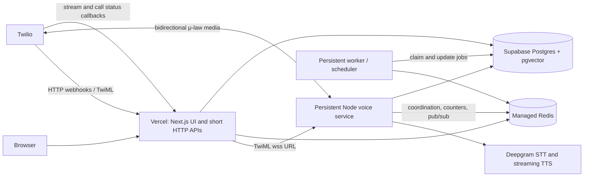

# VOXERA production deployment assessment

## Findings and root-cause status

The reported sequence (hold message, then disconnect) means Twilio executed the returned TwiML through `<Say>`. It does not prove that the later WebSocket handshake succeeded. Repository evidence establishes these code-level risks:

- `app/api/telephony/stream/route.ts` previously called the deprecated WebSocket upgrade API and initialized the handler with placeholder IDs. Twilio custom parameters are only available after the `start` event; the shared handler does correctly read them there. The route now uses the current `upgradeWebSocket` export and emits handshake diagnostics.
- The configured app URL was built directly from `NEXT_PUBLIC_BASE_URL`, with no validation, while the deployed voice service may have a different host. Twilio Media Streams require `wss://`; their URL does not support query parameters. A validated `VOICE_STREAM_URL` override and a configured `VOXERA_PUBLIC_URL` are now supported.
- The installed WebSocket SDK implementation rejects upgrades unless its Vercel runtime context exposes `upgradeWebSocket`. An HTTP route response by itself is not proof of an upgrade. Vercel documentation describes WebSocket support as instance-pinned and bounded by function duration; a long phone call is a poor fit for making the Vercel function the system's sole durable voice process.
- `lib/redis/client.ts` is an in-process memory emulation, not Redis. Queue state, active-call counts, Pub/Sub, and circuit-breaker state are not shared across serverless invocations or separate services.
- `custom-server.ts` starts a permanent scheduler polling loop and owns the raw Node upgrade listener. These are process-level workloads, and cannot be assumed to remain alive in Vercel request handlers.
- `TelephonyStreamHandler` had release paths that could decrement an unacquired slot or release a slot twice. Close while acquisition was pending could also leak a slot. Release is now guarded and idempotent; WebSocket close code/reason is logged.

The code does **not** establish which host currently serves production. Therefore the production disconnection root cause remains unconfirmed. The old `custom-server.ts` comments describe an earlier observed failure and its fix, but are not current production logs. Browser `background.js` extension errors are not used as application evidence.

### Evidence needed to name the live root cause

For one test call, retain the matching Twilio Call SID and capture:

1. Twilio Debugger call error code and the `stream-error` callback's `StreamError`.
2. Incoming webhook response status/body and the emitted `wsUrl` host (do not share secrets or caller numbers).
3. Vercel or voice-service logs for `websocket_handshake_succeeded`, `connected`, `start`, `stt_ready`, and `websocket_closed`.
4. Whether the close occurs before `connected`, before `start`, after `start`, or during Deepgram initialization.
5. Production values/scope for `VOXERA_PUBLIC_URL`, `VOICE_STREAM_URL`, and presence (not value) of `DEEPGRAM_API_KEY`.

Interpretation: Twilio handshake error 31920 or `stream-error` before the handshake log points to URL/routing/upgrade; handshake and `start` followed by close 1011 points to initialization; a Deepgram error before 1011 confirms STT credentials/network/init as the immediate failure. Logs now include lifecycle context without logging credentials, audio, or transcripts.

## Decision actually implemented: everything on Vercel, free (Hobby) plan

Superseding the "Option 3" recommendation below for now — the product has
no deployment budget, so the app runs entirely on Vercel's free Hobby plan
rather than splitting across a separate voice service/worker. This is a
deliberate, accepted tradeoff, not an oversight:

- **Twilio Media Stream WebSocket runs as a Vercel Function**
  (`app/api/telephony/stream/route.ts`, using `upgradeWebSocket` from
  `@vercel/functions`, now GA/public-beta) instead of `custom-server.ts`'s
  raw Node `upgrade` handler. `custom-server.ts` is kept only for local dev
  and optional self-hosting — Vercel's build never runs it.
  - **Hard limit accepted:** every Vercel Function on Hobby is killed at
    300 seconds, no paid toggle available on Hobby. `maxDuration = 300` is
    set explicitly on that route. **Any call longer than 5 minutes will be
    disconnected mid-conversation.** Moving to Pro (800s, or 1800s with the
    extended-duration beta) is the only way to raise this.
- **Follow-up scheduler** moved from `custom-server.ts`'s in-process
  `setInterval` loop to a Vercel Schedule (cron) hitting
  `/api/cron/dispatch` (see `vercel.json`), which calls
  `runScheduledDispatch()` in `lib/scheduler/dispatcher.ts`.
  - **Precision tradeoff accepted:** today's sub-minute wake-timer
    precision is gone. Follow-up calls fire within the Schedule's interval
    window (`*/15 * * * *` as configured — tighten it in the Vercel
    dashboard if the account allows more than every 15 minutes).
- **Redis** (`lib/redis/client.ts`) now backs onto real `ioredis` when
  `REDIS_URL` is set (e.g. an Upstash free-tier instance), required because
  Vercel Functions are separate processes that can't share the old
  in-memory store. Falls back to the original in-memory emulation when
  `REDIS_URL` is unset, so local dev needs no Redis.

## Architecture recommendation

Option 3 is recommended for production: Vercel for the web and short HTTP APIs, a persistent voice process for the Twilio media socket, a separately restartable worker for schedules and long jobs, managed shared Redis for coordination/queues, and Supabase/Postgres as source of truth. This matches the process assumptions already present in the code. Keep the existing single-process Docker/custom-server path available during migration.

| Option | Reliability and latency | Cost and operations | Assessment |
|---|---|---|---|
| 1. Entire app on Vercel | Lowest deployment count; voice depends on function support, duration limits, and per-instance state. Redis must replace local state regardless. | Lowest initial ops; potential per-call function duration/cost and platform constraints. | Suitable for UI and short APIs. Do not make it the only voice runtime until a real long-call Twilio smoke test passes on the selected Vercel plan/runtime. |
| 2. Vercel + voice service | Stable persistent media socket; independent voice scaling and low-latency provider connections. Scheduler still needs a durable worker. | One additional service; clear operational ownership. | A reasonable migration stage if scheduler stays externally scheduled and recoverable. |
| 3. Vercel + voice + worker | Separates sockets and durable jobs; independent restarts/scaling; managed Redis provides shared state. | Highest service count and monitoring needs; cleanest failure recovery boundary. | Recommended: repository has both a long-lived socket and interval scheduler, and local memory cannot coordinate across Vercel instances. |

### Boundaries and environment ownership

- **Vercel:** browser app, Supabase-authenticated CRUD, admin, agent builder, incoming/outgoing Twilio HTTP webhooks, Twilio stream/call callbacks, Stripe callback, short API work. Keep secrets server-only.
- **Voice service:** Twilio WebSocket, audio codec, Deepgram/Gnani live STT/TTS, barge-in, emotion/orchestration, and call lifecycle. It can reuse `lib/telephony/stream-handler.ts` and should be deployed from the same repository revision.
- **Worker:** follow-up scheduler, stuck-call reconciliation, retries, post-call analysis, and long document ingestion. Claim jobs in Postgres or a durable queue, use idempotency keys, and recover leases after restart.
- **Redis:** shared active call coordination, queue/Pub/Sub, and job transport. Redis is not the durable record of patients, calls, agents, or schedules.
- **Supabase:** persistent tenant/business data and pgvector. Keep tenant predicates/RLS and never move business records solely into Redis.

## Subsystem readiness classification

Classification applies to this repository's current code, not an unexecuted production setup.

| Subsystem | Status | Evidence / action |
|---|---|---|
| Authentication and middleware | 2 — config dependent | Supabase SSR session refresh is in `middleware.ts`; production cookie/domain and Supabase redirect URLs need environment verification. Login incident has no application evidence in this repo. |
| Admin dashboard and Agent Builder | 2 — config dependent | Next pages and APIs; verify Vercel build and auth access against production Supabase. |
| Tenant isolation / RLS | 5 — not verified | Many server modules use a service-role Supabase client (bypasses RLS) and manually filter tenant IDs. Audit every privileged route before calling isolation verified. |
| Supabase/Postgres | 2 — config dependent | HTTP Supabase client is compatible; required migrations and service role scope must be checked. Do not run migrations as part of deployment without approval. |
| pgvector / knowledge retrieval | 2 — config dependent | SQL migrations and server-side embedding/retrieval exist; deploy needs pgvector schema, AI keys, and bundle/runtime verification. |
| Redis, active calls, queue, Pub/Sub | 4 — architectural modification | `lib/redis/client.ts` is explicitly process-local memory. It cannot coordinate Vercel invocations or separate voice/worker services. |
| Twilio incoming/outgoing/SMS | 2 — config dependent | HTTP webhook patterns are serverless-friendly; signatures require the canonical public URL and Twilio env vars. Stream callbacks are now added. |
| Media Streams / Deepgram / barge-in | 4 — architectural modification recommended | The stream handler is persistent and uses raw Node WebSockets. Prefer the dedicated Node voice service; validate its host, TLS, duration, and provider credentials. |
| Follow-up scheduling / stuck-call recovery | 4 — architectural modification | Infinite polling starts from `custom-server.ts`; move it to a persistent worker or a durable external scheduler that can safely claim/retry. |
| Outbound and bulk calling | 3 — requires persistent/shared services | Calls need stable public webhook/voice URLs, shared queue state, Twilio credentials, and retry-safe DB claims. |
| Emotion engine / orchestration | 2 — config dependent | Existing code remains in server modules. External inference/model downloads and memory pressure need service bundle/runtime checks. |
| Self-learning / analytics | 3 — requires persistent job execution | Post-call work is launched fire-and-forget in HTTP callback flow; requests may end before it completes. Move durable work to worker jobs. |
| Patient management / call logs | 2 — config dependent | Supabase-backed short HTTP CRUD is suitable with production DB/auth/RLS configuration. |
| Stripe, email, calendar | 2 — config dependent | Webhook secrets, provider credentials, canonical callback URL, and idempotency need deployment verification. |
| Document ingestion / OCR | 5 — not verified on Vercel | `pdfjs-dist`, Tesseract, canvas, workers and model assets are externalized for Node; check function bundle/size, memory, temp storage, and duration. Long processing belongs in the worker. |
| AI/model initialization and caching | 4 — architectural modification for serverless | Warmup and process-memory caches are not durable/shared across function instances; retain them for long-lived voice/worker processes. |
| Realtime dashboard SSE | 3 — requires shared event transport | In-process Pub/Sub only works inside one Node process; Vercel/voice deployment needs shared Redis or another realtime transport. |
| Scheduled jobs / webhooks | 4 — architectural modification | Do not rely on a Vercel invocation surviving past its response. Persist claims/results and retries. |

## Environment variables

Configure only variables actually used by the selected feature. Never put service-role keys or provider secrets in `NEXT_PUBLIC_*` variables.

**Vercel web and HTTP webhooks:** `VOXERA_PUBLIC_URL` (canonical `https://` app origin; use the same exact host configured in Twilio), `SUPABASE_URL`, `SUPABASE_ANON_KEY`, `SUPABASE_SERVICE_ROLE_KEY`, `TWILIO_ACCOUNT_SID`, `TWILIO_AUTH_TOKEN`, `TWILIO_PHONE_NUMBER`, `DEFAULT_CLIENT_ID` if used, `STRIPE_SECRET_KEY`, `STRIPE_WEBHOOK_SECRET`, configured `STRIPE_PRICE_*`, `RESEND_API_KEY`, `GOOGLE_SERVICE_ACCOUNT_EMAIL`, `GOOGLE_PRIVATE_KEY`, `GOOGLE_CALENDAR_ID`, `CREDENTIALS_ENCRYPTION_KEY`, and LLM/embedding keys actually selected (`ZENMUX_API_KEY`, `GROQ_API_KEYS`, `OPENAI_API_KEY`, `HF_TOKEN`/`HUGGINGFACE_API_KEY`). `NEXT_PUBLIC_BASE_URL` remains a legacy fallback; prefer `VOXERA_PUBLIC_URL`.

**Voice service:** `VOICE_STREAM_URL` (full public `wss://` stream endpoint, e.g. `wss://voice.example/api/telephony/stream`), `DEEPGRAM_API_KEY`, optional `GNANI_API_KEY`, optional `ELEVENLABS_API_KEY`, Supabase URL/service role key, Twilio auth token/account SID if REST calls are used, LLM keys, and the same shared Redis connection configuration once a real Redis adapter is adopted.

**Worker:** Supabase URL/service role key, Twilio credentials for outbound dispatch/status reconciliation, LLM keys for post-call analysis, and shared Redis connection settings once queue integration is deployed.

**Vercel (as actually deployed, free Hobby plan):** everything above under "Vercel web and HTTP webhooks", plus:
- `REDIS_URL` — an Upstash (or other) Redis connection string, `rediss://...`. Required for the call queue, circuit breaker, and live-dashboard pub/sub to work correctly once more than one Function instance is running; without it the app silently falls back to a non-shared in-memory store (fine for local dev, incorrect in production).
- `CRON_SECRET` — any random string, also set as the project's Cron secret in the Vercel dashboard. Verified by `/api/cron/dispatch` to reject non-Vercel callers.

The stream callback columns, tenant MCP connections, and reusable custom tool registry are code-prepared but their migrations are **not applied**. Review and run `sql/migration_v32.sql`, `sql/migration_v33.sql`, and `sql/migration_v34.sql` in the Supabase environment before enabling stream callback persistence, MCP connections, or custom tools in production. MCP and custom tool credentials require a strong `CREDENTIALS_ENCRYPTION_KEY` shared by the web and voice services.

## Deployment sequence

1. **Prepare Supabase:** back up/check schema, review and apply migrations in order including `sql/migration_v32.sql`, `sql/migration_v33.sql`, and `sql/migration_v34.sql`, verify RLS and tenant scoping, then smoke-test service-role and user-scoped paths.
2. **Prepare Redis:** provision a managed Redis-compatible service with TLS and separate credentials per environment. Replace `lib/redis/client.ts` with a shared implementation that supports the current command surface and subscription semantics before separating processes. Do not use local memory for multi-instance production.
3. **Deploy voice Node service:** build from this repo with Node 20 and `npm ci`; start the dedicated voice entrypoint on the platform's assigned port; configure TLS/custom domain, health checks, restart policy, resource/connection limits, provider secrets, Supabase, and Redis. Point `VOICE_STREAM_URL` to its `wss://` endpoint. Keep the current Docker/custom-server entrypoint as the migration baseline until the new voice entrypoint is implemented and verified.
4. **Deploy worker:** run a dedicated persistent worker process with bounded concurrency, graceful shutdown, DB/Redis access, retry/lease recovery and idempotency. Do not start `startSchedulerPolling()` in Vercel.
5. **Deploy Vercel web app:** use the Next.js 16 Vercel adapter/default build, configure production-only environment variables and canonical `VOXERA_PUBLIC_URL`, then set Twilio incoming, outgoing, call-status and Stripe webhook URLs to the production domain. Set `VOICE_STREAM_URL` only after the voice endpoint passes external WebSocket checks.
6. **Local development:** `npm run dev` for UI/API development. Use `npm run dev:full` with `.env.local` for integrated local telephony; expose the service through a TLS tunnel and set explicit public app/voice URLs. Do not test calls against a localhost `wss://` URL.

Deployment config for the future independent voice and worker entrypoints is intentionally not fabricated: neither entrypoint nor a shared Redis implementation exists yet. The current `Dockerfile` is for the integrated custom Node server and is not a Vercel deployment config.

## Verification and production smoke checklist

Automated repository checks do not replace a real Twilio call. Once services/configuration are deployed:

1. Inspect Twilio's POST body/signature acceptance and returned TwiML; confirm `<Stream url="wss://…">` uses the voice domain and an absolute stream callback.
2. Call the actual Twilio number, answer, hear the hold prompt, then hear the configured agent greeting.
3. Speak a question; verify a transcript, agent response, streaming TTS delivery, emotion/orchestration activity, and call/session rows.
4. Interrupt the agent mid-sentence and verify audio clears and the new caller turn is answered.
5. Hang up; verify `stream-stopped`, call completion, worker/post-call records, and active Redis count returns to baseline.
6. Repeat a second call to verify the counter and voice service remain healthy.
7. Test a failed Deepgram key in staging and verify `stream-error` or structured initialization failure, socket close code/reason, failed call status, and exactly-once slot release.
8. Stop/restart the worker with a due task and verify lease recovery, no duplicate patient call, bounded retries, and visible failure record.

## Instrumentation added in this change

- Incoming call/TwiML logs include event timestamp, call/tenant/agent identifiers and final websocket/callback URLs.
- WebSocket handshake and close logs include close code/reason; the handler logs slot-release failures with session context.
- Twilio `stream-started`, `stream-stopped`, and `stream-error` callbacks are signature-validated when `TWILIO_AUTH_TOKEN` is configured, associated to `call_logs` by Call SID and tenant, and persist stream SID/status/error/time.
- `sql/migration_v32.sql` adds the callback fields. The callback endpoint returns a failure status if it cannot associate or persist the event, so Twilio retries can surface rather than silently dropping diagnostics.

This does not yet provide centralized latency histograms or queue/worker metrics. Those require the shared service boundaries and a metrics backend; do not infer they exist from log lines.
